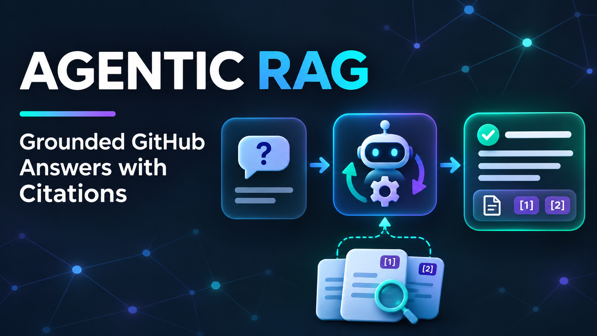

# Agentic RAG

An evidence-grounded RAG backend that combines live GitHub retrieval with an
indexed-document pipeline for Notion. LangGraph coordinates validated planning,
bounded replanning, evidence assessment, answer synthesis, and claim-level
citations.


## Demo

### First Iteration

[](https://youtu.be/PzV2aMexqn4)

The demo shows query planning, live GitHub retrieval, evidence assessment,
answer synthesis, and citations resolved to their original source URLs.


## Project Status

The live GitHub flow is operational. Notion acquisition, normalization,
chunking, and embedding evaluation are implemented; persistent vector storage
and LangGraph integration are the next milestone.

| Capability | Status |
|---|---|
| GitHub live retrieval | Implemented |
| Validated planning and bounded replanning | Implemented |
| Evidence assessment and claim-level citations | Implemented |
| Notion acquisition and normalization | Implemented |
| Structure-aware, token-aware chunking | Implemented |
| Embedding-model evaluation | Implemented |
| Persistent vector storage | Next milestone |
| Indexed Notion retrieval in LangGraph | Next milestone |

## GitHub Retrieval Tools

| Tool | Purpose |
|---|---|
| `github.search` | Search issues and pull requests |
| `github.get_issue` | Retrieve a known issue or a PR's common fields |
| `github.list_issue_comments` | Retrieve general issue or PR discussion comments |

PR common fields do not establish merge status or review decisions.
General discussion comments do not include inline code-review comments.

## Notion Ingestion

The offline ingestion pipeline currently supports:

- Recursive page acquisition and explicit document and block contracts.
- Text blocks, lists, headings, tables, child pages, and page links.
- Structure-aware chunks that preserve titles, heading paths, and source
  metadata.
- Deterministic identifiers and token-aware splitting of oversized content
  without silent truncation.
- Local embedding evaluation with normalized dense vectors.

Media, file attachments, embeds, advanced blocks, and Notion databases are
outside the current ingestion scope. An unsupported block does not invalidate
the rest of a supported page.

## Processing Flow

```text
User question
    ├─ clear general question → direct answer
    └─ tool-related or ambiguous question
        → LLM decomposition → planning
            └─ tool execution → normalization → assessment → synthesis
                               → citation validation → source-link resolution
    → API response
```

Planning returns `executable`, `clarification_required`, `unsupported`, or
`no_tool_required`. Tool calls have bounded retries and timeouts. Sufficient or
partial evidence reaches synthesis; insufficient evidence can trigger one
bounded correction attempt. Partial answers retain explicit limitations, while
invalid assessment or synthesis output is reported as a separate stage error.

## Development Setup

Requires Python 3.12.

Install the application and test dependencies, then verify the environment:

```bash
python -m pip install -e ".[test]"
python -m pip check
```

Run deterministic tests without external services:

```bash
python -m pytest -m "not live" -q
```

Run opt-in tests that use services such as LM Studio, GitHub, or Notion:

```bash
python -m pytest -m live -q
```

Lint and check formatting with Ruff:

```bash
ruff check .
ruff format --check .
```

Apply available automatic fixes and formatting:

```bash
ruff check . --fix
ruff format .
```

Ruff cannot automatically fix every reported issue. Review the changes
and rerun the checks afterward.

## Run the API

Start LM Studio's OpenAI-compatible server at `http://localhost:1234/v1` with
the configured `qwen/qwen3-8b` model loaded, then start FastAPI:

```bash
python -m uvicorn agentic_rag.api.app:app --reload --log-level info
```

Open Swagger at `http://127.0.0.1:8000/docs`.

## Try It Locally

Submit to `POST /query`:

```json
{
  "query": "What is the current production rollout status of the Payment Retry Release according to GitHub issues #1 and #2 and their discussion comments in rajashree23/agentic-rag-demo-data?"
}
```

The demo data contains an original rollout requirement and a later update. The
response includes execution metadata, normalized evidence, its assessment,
cited claims, limitations, and resolved source URLs.

## Validation Boundaries

Implemented checks include structured model validation, assessment evidence
references, claim-level citation requirements, citation scope, duplicate
evidence-ID rejection during source resolution, and response-state consistency.

A valid citation reference does not prove that the evidence supports the
claim. Source resolution does not verify URL accessibility.

## Embedding Model Evaluation

Three open-source embedding models were evaluated on the same 19 Notion chunks
and 15 labelled queries at retrieval depth `k = 5`. The query set contains both
single-fact and multi-evidence questions. These are initial, domain-specific
local results rather than general benchmark claims.

| Model | Recall@5 | MRR | nDCG@5 | Mean query latency |
|---|---:|---:|---:|---:|
| BAAI/bge-small-en-v1.5 | 86.7% | 0.789 | 0.780 | 8.7 ms |
| Qwen/Qwen3-Embedding-0.6B | **93.3%** | **0.922** | **0.878** | 39.3 ms |
| IEITYuan/Yuan-embedding-2.0-en | 90.0% | 0.889 | 0.838 | 39.0 ms |

`Qwen/Qwen3-Embedding-0.6B` is the current selection because it produced the
best retrieval quality while fitting comfortably on the development GPU. The
evaluation also records Hit Rate@5, Precision@5, indexing time, memory usage,
vector storage, and input-limit compatibility. See the
[evaluation results](docs/evaluations/offline-ingestion/embedding-model-evaluation-results.md)
for the complete methodology and measurements.

## Retrieval Strategy

The system separates two retrieval modes that produce the same downstream
evidence contract:

- **Live retrieval:** GitHub API tools fetch current operational records when a
  question requires fresh source data.
- **Indexed retrieval:** Notion pages are acquired offline, normalized,
  chunked, embedded, and stored for semantic search.

## Next Milestone

1. Persist Notion documents, chunks, metadata, and embeddings.
2. Implement chunk replacement, deletion, and revision handling.
3. Expose indexed retrieval through the common evidence contract.
4. Route live and indexed retrieval through the main LangGraph workflow.
5. Evaluate hybrid search or reranking after establishing the dense baseline.

Production hardening will also require authentication, authorization,
prompt-injection controls, semantic-grounding evaluation, and observability.

## Documentation

- `docs/system-contract.md`: intended scope and requirements.
- `docs/architecture.md`: architectural direction.
- `docs/schemas/`: stage contracts.
- `docs/adr/offline-ingestion/`: Notion scope, chunking, and record-contract
  decisions.
- `docs/evaluations/offline-ingestion/embedding-model-shortlist.md`: embedding
  shortlist and evaluation method.
- `docs/evaluations/offline-ingestion/embedding-model-evaluation-results.md`:
  measured retrieval and operational results.
